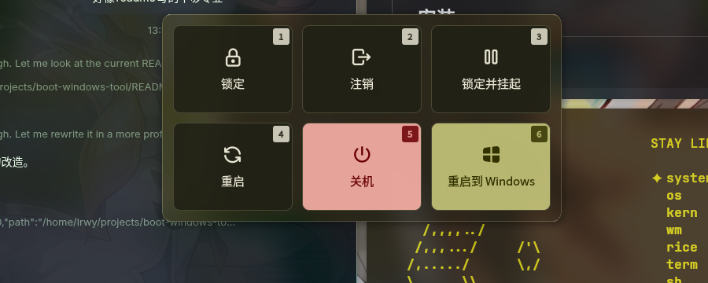

<div align="center">

# boot-windows

**在 Linux 上一键临时切到 Windows —— 不用进 GRUB 菜单手动选。**

[](LICENSE)
[](boot-windows)
[](install/install.sh)

Linux 始终是你系统的默认启动项。这只是一次性切换：从 Windows 再开机会自动回到 Linux。

</div>

---

## 目录

- [它解决什么问题](#它解决什么问题)
- [工作原理](#工作原理)
- [为什么不用 systemd 的 boot-loader-entry](#为什么不用-systemd-的-boot-loader-entry)
- [安装](#安装)
- [用法](#用法)
- [集成到桌面会话菜单](#集成到桌面会话菜单)
- [权限模型](#权限模型)
- [环境变量](#环境变量)
- [已知限制](#已知限制)
- [故障排查](#故障排查)
- [相关项目](#相关项目)
- [参与贡献](#参与贡献)
- [许可证](#许可证)

---

## 它解决什么问题

Linux + Windows 双系统，用户想临时用一次 Windows。传统做法是：

1. 重启
2. 等 GRUB 倒计时
3. 用方向键选中 Windows Boot Manager
4. 回车

这个过程要盯着屏幕、要在几秒内抢时间按对键，而且 GRUB 菜单项的位置取决于 os-prober 生成的条目顺序，不稳定。

`boot-windows` 把这件事变成**一个按钮**。



## 工作原理

UEFI 规范定义了两个独立的启动变量：

| 变量 | 作用 | 生命周期 |
|---|---|---|
| `BootOrder` | **持久**的启动顺序列表 | 永久，直到被显式修改 |
| `BootNext` | **一次性**覆盖，下次启动生效 | 用完即弃（固件不自动清除，但被消费后失效） |

本工具只写 `BootNext`，**从不触碰 `BootOrder`**：

```
                 ┌─────────────────────────────────────┐
                 │            BootOrder = 0001,0002,... │
                 │            (Linux 始终在首位)        │
                 └─────────────────────────────────────┘
                                    │
   正常开机 ─────────────────────────┼──────► Linux
                                    │
   执行 boot-windows                │
        │                           │
        ▼                           │
   BootNext = 0002                  │
   (Windows Boot Manager)           │
        │                           │
        ▼                           │
   固件跳过 GRUB 菜单 ──────────────┴──────► Windows
                                            │
   在 Windows 里再开机 ───────────────────────┴──────► Linux ✓
```

关键性质：

- **无侵入**：不修改默认启动顺序，不碰 GRUB 配置，不装引导器
- **一次性**：`BootNext` 只影响下一次启动。从 Windows 再开机就回到 Linux，无需人工干预
- **可回退**：若 `BootNext` 指向的启动项失效，固件按规范回退到 `BootOrder`（Linux），不会变砖
- **可撤销**：任何时候 `boot-windows --restore` 即可清除

### 目标启动项的定位

脚本按两级策略查找 Windows 启动项，以提高跨机器兼容性：

1. **按描述匹配** —— `efibootmgr -v` 输出中的 `Windows Boot Manager`（UEFI 标准的描述字符串）
2. **按路径匹配** —— 兜底匹配 `bootmgfw.efi` 或 `microsoft`（Windows 的引导文件路径，与固件语言无关）

第二级策略存在的原因：部分主板固件会本地化启动项描述，或使用 OEM 自定义描述，此时第一级会失败。

## 为什么不用 systemd 的 boot-loader-entry

systemd 提供了官方的接口：

```bash
systemctl reboot --boot-loader-entry=<ID>
```

但它**只支持 systemd-boot 和 BLS（Boot Loader Specification）**。GRUB 用户调用会失败：

```
No boot loader entries discovered.
```

这是因为 systemd 通过读取 BLS 片段（`/boot/loader/entries/*.conf`）来枚举启动项，而 GRUB 不使用这套格式。

因此本工具直接操作 UEFI 变量，走 `efibootmgr --bootnext`。

> 如果你的系统用的是 **systemd-boot**，直接用 `systemctl reboot --boot-loader-entry=` 更合适，本工具不是必需的。

## 安装

### 依赖

| 依赖 | 用途 | 必需 |
|---|---|---|
| UEFI 固件 | `BootNext` 机制本身 | ✅ |
| `efibootmgr` | 读写 EFI 变量 | ✅ |
| `zenity` | GUI 确认对话框 | 可选 |
| `notify-send` | 切换通知 | 可选 |
| `Noctalia` | 会话菜单集成 | 可选 |

### 安装脚本

```bash
# Arch / CachyOS
sudo pacman -S efibootmgr

git clone https://github.com/linruowuyin/boot-windows.git
cd boot-windows
./install/install.sh
```

安装脚本的行为：

1. 检查 UEFI 模式与 `efibootmgr` 是否可用
2. 把 `boot-windows` 安装到 `~/.local/bin/`（可用 `BIN_DIR` 覆盖）
3. 若检测到 Noctalia，自动向其会话菜单追加「重启到 Windows」条目
4. 幂等：重复运行不会产生重复条目

### 手动安装

```bash
install -m 0755 boot-windows ~/.local/bin/boot-windows
```

## 用法

```
boot-windows              设置 BootNext → Windows，然后重启
boot-windows --no-reboot  只设置 BootNext，不重启
boot-windows --gui        弹确认框（zenity）后执行
boot-windows --status     显示启动项与 BootNext 状态
boot-windows --restore    清除 BootNext（下次开机回 Linux）
boot-windows --dry-run    打印将要执行的动作，不做任何修改
boot-windows --help       显示帮助
```

实际输出示例：

```
$ boot-windows --status
BootCurrent: 0001
BootOrder: 0001,0002,2001,2002,2003
Windows 启动项 = Boot0002
→ 下次启动按 BootOrder 顺序
```

## 集成到桌面会话菜单

### Noctalia

`install/install.sh` 会自动完成。手动配置则在 `~/.config/noctalia/noctalia-config.toml` 中追加：

```toml
[[shell.session.actions]]
action = "command"
command = "/home/<user>/.local/bin/boot-windows --gui --yes"
countdown_seconds = 3.0
enabled = true
glyph = "brand-windows-filled"
label = "重启到 Windows"
lockscreen_shortcut = ""
shortcut = "6"
variant = "secondary"
```

> **配置要点**（Noctalia 的 session action 行为缺少文档，以下均为实测结论）
>
> - `action` 的合法值是 **`command`**，**不是** `custom`。填 `custom` 会被静默跳过 —— 面板不渲染，也不报错。
> - `enabled = true` 必须显式设置。Noctalia 默认模板中该项为 `enabled = false` 的占位槽。
> - 菜单项超过 6 个时，单行布局会溢出并被裁剪。需在配置中加入：
>   ```toml
>   [shell.session]
>   grid = true
>   grid_columns = 3
>   ```
> - `glyph` 必须是 Noctalia 图标字体中真实存在的字形名。可用 `brand-windows-filled`（字体：`noctalia-tabler.ttf`）。
> - Noctalia 进程的 `PATH` 中**不包含** `~/.local/bin`，因此 `command` 必须写绝对路径。

### 其它桌面环境

创建 `~/.local/share/applications/boot-windows.desktop`：

```ini
[Desktop Entry]
Type=Application
Name=重启到 Windows
Comment=一次性重启到 Windows
Exec=/home/<user>/.local/bin/boot-windows --gui
Icon=preferences-system
Terminal=false
Categories=System;
```

## 权限模型

写入 EFI 变量需要 root 权限。本工具的实现：

1. **优先尝试免密 sudo** —— `sudo -n /usr/bin/sh -c "<cmd>"`
2. **仅当**免密失败且错误信息表明需要密码时，才回退到交互式 `sudo`

这样做的原因：免密探测如果命中真实故障（例如设备不存在），交互式回退会导致同一操作被执行两次。

### 配置免密 sudo（可选）

在 `/etc/sudoers.d/` 中添加：

```
<user> ALL=(ALL) NOPASSWD: /usr/bin/sh
```

> ⚠️ **注意**：不要写成 `/usr/bin/sh ""`。
> 根据 `man sudoers`：`""` 表示「仅允许无参数调用」，会把带参数的调用全部拒绝，导致工具完全不可用。
> 不写参数则表示「允许任意参数」。

> ⚠️ 该规则允许免密执行任意 shell 命令，安全性等同于给该用户 root。评估后再决定是否采用。

### 重启方式

使用 `systemctl reboot` 而非 `org.freedesktop.login1` D-Bus 接口。后者在 Wayland 桌面环境下常常不可用 —— polkit 认证 agent 未必在运行，调用会静默挂起或失败。

## 环境变量

| 变量 | 默认值 | 说明 |
|---|---|---|
| `WINDOWS_PART` | 自动探测 | 指定用于休眠状态检测的 NTFS 分区设备路径 |
| `REBOOT_DELAY` | `3` | 调用重启前的等待秒数，留出通知显示时间 |

## 已知限制

- **仅支持 UEFI**。Legacy BIOS / CSM 引导的系统没有 `BootNext` 变量。
- **需要固件中存在 Windows 启动项**。部分 Linux 安装过程不会自动创建它。
- **Windows 快速启动会干扰切换**。若 Windows 启用了 Fast Startup，NTFS 卷会保留休眠标记，切过去可能看到「恢复上次会话」而非冷启动。详见[故障排查](#故障排查)。
- **`BootNext` 不会被固件自动清除**。它在下次启动时被消费而失效，但如果你在设置后再次重启到 Linux 之前又手动清除了它，`--restore` 可以随时清理。
- **多 Windows 实例时选择第一个匹配项**。脚本找到首个匹配即停止，不提供交互选择。

## 故障排查

### 切过去后 Windows 显示「恢复会话」而非冷启动

Windows 的快速启动（Fast Startup）会让 NTFS 卷保持锁定状态。

**解决**：在 Windows 中以管理员身份打开 PowerShell，关闭快速启动：

```powershell
powercfg /h off
```

工具会在切换前检测并提示：读取 NTFS boot sector 的第 4 字节，`0xC1` 表示卷处于休眠/快速启动状态（正常值为 `0x4E`）。

### 提示找不到 Windows 启动项

说明固件的启动项列表里没有 Windows 入口。检查：

```bash
efibootmgr -v
```

若列表中确实没有，请进入固件设置手动创建指向 `\EFI\Microsoft\Boot\bootmgfw.efi` 的启动项。

### 会不会破坏默认启动顺序

不会。工具只写 `BootNext`，从不修改 `BootOrder`。随时可用 `boot-windows --status` 核对。

### `sudo` 一直要密码

说明免密规则未生效。检查：

```bash
sudo -n -l
```

如果输出中没有 `/usr/bin/sh`，按[权限模型](#权限模型)添加规则，或直接依赖交互式回退（脚本会自动处理）。

### 切换后仍然进了 GRUB 菜单

`BootNext` 可能未成功写入。检查：

```bash
efibootmgr -v | grep BootNext
```

若有输出但未生效，说明该固件对 `BootNext` 的支持不完整 —— 某些消费级固件会忽略它。此时可改用 GRUB 方案：

```bash
grub-reboot <menuentry-id>
```

## 相关项目

- [`efibootmgr`](https://github.com/rhboot/efibootmgr) — EFI 变量管理工具，本项目底层依赖
- [`systemd`](https://github.com/systemd/systemd) — 提供 `systemctl reboot --boot-loader-entry`，但仅限 systemd-boot / BLS
- [`grub-reboot`](https://www.gnu.org/software/grub/manual/grub/html_node/Invoking-grub-reboot.html) — GRUB 的一次性启动项切换，BootNext 的等价替代方案
- [`Noctalia Shell`](https://github.com/noctalia-app/noctalia-shell) — Wayland 桌面 Shell，本项目为其提供会话菜单集成

## 参与贡献

欢迎提 issue 和 PR。开发约定见 [CONTRIBUTING.md](CONTRIBUTING.md)。

提交前请确保本地通过检查（CI 会跑同样的项目）：

```bash
bash -n boot-windows install/install.sh
shellcheck -S warning boot-windows install/install.sh
```

## 许可证

[MIT](LICENSE) © 2026 boot-windows contributors
